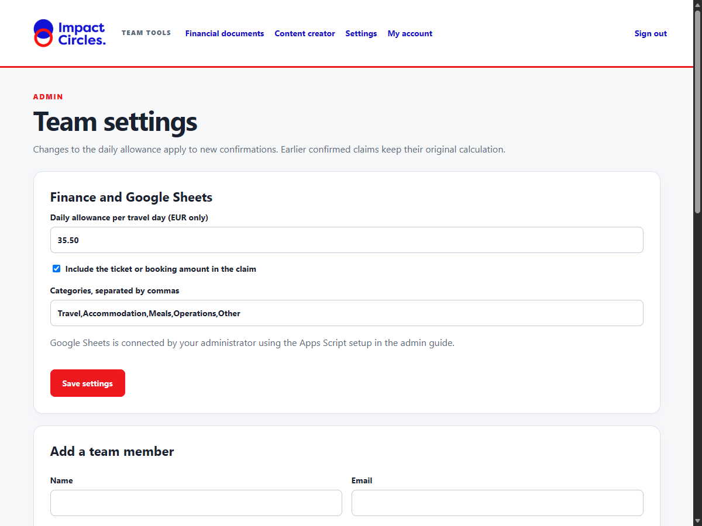

# Impact Circles Administrator Guide

This guide covers administrative setup, user accounts, duplicate claim exceptions, Google Sheets Apps Script integration, operational quotas, and backup/restore procedures.

---

## 1. Account Management & Access Controls

### Initial Admin Bootstrap
When the application starts for the very first time with an empty database, it reads `BOOTSTRAP_ADMIN_EMAIL` and `BOOTSTRAP_ADMIN_PASSWORD` from the environment and creates the initial admin account.

> [!IMPORTANT]
> **Bootstrap Idempotence:** The bootstrap check runs *only* if the `users` table contains zero records (`SELECT COUNT(*) FROM users == 0`). On subsequent restarts, existing user accounts, passwords, and display names in SQLite remain completely untouched. Changing `.env` credentials will *not* overwrite an existing admin password or create duplicate users.

### User Roles & Permissions
The system supports two user roles:
- **Member:** Can upload documents, submit claims, delete their own unconfirmed claim drafts, see their own claim history and daily allowance usage, create and edit drafts for assigned projects, and approve their own drafts. Members cannot view organization-wide history.
- **Admin:** Has full access to all historical records, settings, user management, project owner assignment, and the duplicate claims review queue.

### Remove an unconfirmed claim draft

The uploader can open an unconfirmed claim in **My claim history** and click **Delete draft** at the bottom of the review page. Admins can delete any unconfirmed claim from **Recent documents**. After the browser confirmation, the draft and its uploaded file are removed. The option is unavailable for confirmed claims; a confirmed claim may already have been exported to Google Sheets and needs a finance correction process rather than deletion. Deleting a draft does not change confirmed allowance totals.

### Managing Users in Settings (`/admin`)
1. **Add Team Member:** Enter the member's display name, work email, initial temporary password (minimum 12 characters), and select role (*Team member* or *Admin*).
2. **Display Names:** Users are given an initial display name derived from their email prefix, which admins can update to their full legal or working name at any time. When a claim or content draft is confirmed or approved, the user's display name and email are permanently snapshotted into the record and exported to Google Sheets.
3. **Disable / Enable Accounts:** Click **Disable** next to any account. Disabled accounts cannot log in, and any existing active sessions for that account are immediately invalidated by database session checks.
4. **Project Owners:** Under **Settings → Project owners**, admins can reassign the primary owner of any project. Members can view and create content drafts only for projects assigned to them.



Under **Finance and Google Sheets**, enter one **Daily allowance per travel day (EUR only)** amount. The app applies it to every eligible travel day regardless of the ticket currency. It converts foreign-currency booking costs using the dated daily ExchangeRate-API rate. Confirmed claims keep their saved rate and calculation; changing this setting affects future confirmations. If the rate API is unavailable or its data is too old, foreign-currency claims cannot be confirmed until a recent quote is available.

The EUR-only migration keeps the existing EUR allowance and removes old USD/EGP settings from the database. It does not rewrite confirmed historical claims. Their paid days still prevent a second allowance on overlapping dates; old non-EUR allowance amounts remain visible in their claim history rather than being added to the new EUR subtotal.

---

## 2. Duplicate Detection & Review Queue

### How Duplicates are Detected
When a user uploads or confirms a financial document, the application inspects all existing confirmed records:
1. **Exact File Hash:** Calculates SHA-256 of the uploaded file bytes.
2. **Normalized Invoice Match:** Normalizes invoice numbers and vendor names (removing punctuation, spaces, and converting to lowercase). If both match a confirmed claim, a duplicate is flagged.

### Admin Review Queue
- If a duplicate is detected, the claim status changes to **Needs admin review** and the earlier record's ID is stored in `duplicate_of`.
- **Enforcement:** Non-admin members cannot confirm a flagged claim, even if they edit invoice fields.
- **Admin Override:** In `/finance`, admins see a dedicated **Needs admin review (N)** queue. An admin can inspect the earlier claim side-by-side. If the document is a legitimate separate expense (e.g. two legitimate recurring monthly invoices with identical vendor names or different travel legs), the admin can check **Override duplicate flag**, enter a mandatory **Reason for approving exception** (minimum 5 characters), and confirm the claim.
- **Concurrency Safety:** Confirmation performs `BEGIN IMMEDIATE` on SQLite, serializing simultaneous submissions and preventing race conditions where two users upload duplicate documents simultaneously.
- **Detection Heuristics & Limits:** This heuristic catches identical files and common invoice re-submissions, but cannot detect completely different invoice numbers, misspelled vendor names, or unregistered cash receipts. Admins must maintain periodic human reconciliation.

---

## 3. Google Sheets Integration via Google Apps Script

Confirmed finance claims and approved content drafts are automatically exported to the configured Google Spreadsheet via an Apps Script webhook. Google Drive sharing must be configured separately before it becomes a team Sheet.

```text
[ Browser / Staff ]
       │  (HTTPS POST)
       ▼
[ FastAPI App (Render / VPS) ]
       │  (Outbound HTTPS POST with shared secret)
       ▼
[ Google Apps Script Webhook (/exec) ]
       │  (Script Lock + Column A ID Deduplication)
       ▼
[ Google Sheets (Finance & Content tabs) ]
```

### Exact Spreadsheet Schema

Create a Google Spreadsheet with two sheets named exactly **Finance** and **Content**. Set the first row headers exactly as follows:

#### Finance Tab (26 Columns, A through Z):
| Col | Header | Description |
|---|---|---|
| A | `ID` | Formatted claim ID (`F-<id>`) used for deduplication |
| B | `Confirmed at` | UTC timestamp of claim confirmation |
| C | `Traveller` | Name of the travelling team member |
| D | `Type` | Document type (`invoice`, `receipt`, `flight`, `hotel`, `train`, `other`) |
| E | `First date` | Start date of travel (`YYYY-MM-DD`) |
| F | `Last date` | End date of travel (`YYYY-MM-DD`) |
| G | `Origin` | Departure city or airport |
| H | `Destination` | Arrival city or airport |
| I | `Vendor` | Merchant, airline, or supplier name |
| J | `Category` | Accounting category (e.g., *Travel*, *Accommodation*) |
| K | `Document amount` | Original invoice or ticket amount (numeric) |
| L | `Days` | Payable travel days after removing days already claimed by this account (numeric) |
| M | `Daily rate` | Daily allowance rate in EUR (numeric) |
| N | `Allowance` | Total calculated daily allowance in EUR (numeric) |
| O | `Total EUR` | Stored final EUR claim amount (numeric) |
| P | `Total currency` | Always `EUR` |
| Q | `Source file` | Original uploaded filename |
| R | `Description` | Staff notes or claim justification |
| S | `Review link` | Direct HTTPS URL to view claim in the application |
| T | `Source currency` | Original invoice or booking currency (e.g., `USD`, `EGP`, `EUR`) |
| U | `Invoice number` | Vendor invoice or ticket identifier |
| V | `Invoice date` | Invoice issue date (`YYYY-MM-DD`) |
| W | `Created by name` | Name snapshot of the staff member who uploaded the document |
| X | `Created by email` | Email snapshot of the uploader |
| Y | `Confirmed by name` | Name snapshot of the user (or admin) who confirmed the claim |
| Z | `Confirmed by email` | Email snapshot of the confirmer |

#### Content Tab (13 Columns, A through M):
| Col | Header | Description |
|---|---|---|
| A | `ID` | Formatted draft ID (`C-<id>`) used for deduplication |
| B | `Approved at` | UTC timestamp of approval |
| C | `Title` | Content draft title |
| D | `LinkedIn` | Full text of approved LinkedIn post |
| E | `Newsletter` | Full text of approved Newsletter section |
| F | `Website` | Full text of approved Website article |
| G | `Status` | Post status (`Approved` or `Published`) |
| H | `Project` | Associated project name |
| I | `Review link` | Direct HTTPS URL to view draft in the application |
| J | `Created by name` | Name snapshot of the draft creator |
| K | `Created by email` | Email snapshot of the creator |
| L | `Approved by name` | Name snapshot of the approver |
| M | `Approved by email` | Email snapshot of the approver |

### Deployment Steps
1. In your organization Google Spreadsheet, click **Extensions → Apps Script**.
2. Replace all existing script code with the complete webhook code below.
3. Under **Project Settings (gear icon) → Script Properties**, add two properties:
   - `SPREADSHEET_ID`: The ID string extracted from your Google Sheets URL (the string between `/d/` and `/edit`).
   - `SHEETS_WEBHOOK_SECRET`: A secure, unguessable random string of at least 24 characters (generate on the setup computer using `uv run python -c "import secrets; print(secrets.token_urlsafe(32))"`).
4. Click **Deploy → New deployment**.
   - Select type: **Web app**.
   - Description: `Impact Circles Tools Webhook v1`.
   - Execute as: **Me** (the organization-owned Google account owning the sheet).
   - Who has access: **Anyone** (the backend calls this webhook using HTTPS POST with the shared secret; anonymous web app access is required because Google Apps Script does not accept standard API bearer tokens for web app endpoints).
   - Authorize the script when prompted by Google.
5. Copy the deployed web app URL (ending in `/exec`).
6. Set `SHEETS_WEBHOOK_URL` to the copied `/exec` URL and `SHEETS_WEBHOOK_SECRET` to **the exact same secret** as the Apps Script property in your server environment (`.env` or Render environment settings). The URL must start with `https://script.google.com/macros/s/` and must not include query parameters.
7. Restart or redeploy the application. Confirm a synthetic finance claim and check its `F-...` row in Finance; approve a synthetic content draft and check its `C-...` row in Content. If either export fails, inspect **Executions** in Apps Script and the app's error message, correct the settings, and use **Try Sheets again**. Deploy a new version of the web app after changing its code.

> [!NOTE]
> **Verification status (2026-11-05):** A local synthetic claim reached the connected Finance Sheet. The Sheet was still private to its owner; organization sharing and hosted acceptance remain to be checked before team rollout.

### Webhook code for Apps Script

Paste this entire block into the Apps Script editor in deployment step 2:

```javascript
// Configure SPREADSHEET_ID and SHEETS_WEBHOOK_SECRET in Script Properties.
// Deploy as a web app that executes as the organization-controlled account.
function doPost(e) {
  const lock = LockService.getScriptLock();
  try {
    const props = PropertiesService.getScriptProperties();
    const body = JSON.parse(e.postData.contents);
    const secret = props.getProperty('SHEETS_WEBHOOK_SECRET');
    if (!secret || secret.length < 24 || body.secret !== secret) throw new Error('Unauthorized');
    const widths = { Finance: 26, Content: 13 };
    if (!Object.prototype.hasOwnProperty.call(widths, body.tab) ||
        !Array.isArray(body.values) || body.values.length !== widths[body.tab]) throw new Error('Invalid row');
    const id = body.values[0];
    if (typeof id !== 'string' || !(body.tab === 'Finance' ? /^F-\d+$/ : /^C-\d+$/).test(id)) {
      throw new Error('Invalid ID');
    }
    lock.waitLock(20000);
    const sheet = SpreadsheetApp.openById(props.getProperty('SPREADSHEET_ID')).getSheetByName(body.tab);
    if (!sheet) throw new Error('Missing tab');
    const count = sheet.getLastRow();
    const ids = count > 1 ? sheet.getRange(2, 1, count - 1, 1).getValues() : [];
    if (!ids.some(row => String(row[0]) === id)) {
      const values = body.values.map((value, index) => {
        const text = value == null ? '' : String(value);
        if (body.tab === 'Finance' && index >= 10 && index <= 14 && /^\d+(\.\d+)?$/.test(text)) {
          return Number(text);
        }
        // Treat generated and extracted values as text, never sheet formulas.
        return /^\s*[=+@-]/.test(text) ? "'" + text : text;
      });
      sheet.getRange(Math.max(2, count + 1), 1, 1, values.length).setValues([values]);
      SpreadsheetApp.flush();
    }
    return reply({status: 'ok', id: id});
  } catch (error) {
    console.error('Sheets sync failed: ' + String(error.message || error));
    // Do not disclose request data or credentials in the response.
    return reply({status: 'error'});
  } finally {
    if (lock.hasLock()) lock.releaseLock();
  }
}

function reply(value) {
  return ContentService.createTextOutput(JSON.stringify(value)).setMimeType(ContentService.MimeType.JSON);
}
```

### Script Invariants & Security
- **LockService:** Uses `LockService.getScriptLock()` with a 20-second wait to prevent concurrent Google Sheets edit collisions.
- **Deduplication:** Checks Column A. If `F-<id>` or `C-<id>` already exists, the script returns `{ status: "ok", id: id }` without adding a duplicate row.
- **Formula Injection Defense:** Extracted strings beginning with `=`, `+`, `-`, or `@` are prefixed with a single quote (`'`), preventing spreadsheet formula injection.
- **Google Sheets Permissions:** App user roles (admin/member) do *not* grant or restrict access to the Google Spreadsheet. Access to the spreadsheet itself must be managed directly in Google Drive. Keep the spreadsheet restricted to authorized financial and management personnel.

---

## 4. Quotas, Failure Recovery & Operational Limits

### Apps Script Quotas
Google enforces [Apps Script quotas](https://developers.google.com/apps-script/guides/services/quotas), which vary by account type and can change. Monitor the script's executions and errors in Apps Script, especially if team usage grows. The webhook runs when the app sends an HTTP request; it does not require a scheduled trigger.

### Resolving Sync Errors
If an export fails (network timeout, temporary Google outage, or invalid credentials):
1. The record is safely stored in SQLite with `sheet_error` populated.
2. The review page displays an alert with a **Try Sheets again** button.
3. If Google returns HTTP 401 or 403, check that the Web App deployment is set to *Anyone* and that Google Workspace policy permits external web apps.
4. If the error mentions *Invalid row*, verify that the spreadsheet tabs have exactly 26 columns in Finance and 13 columns in Content.
5. Clicking **Try Sheets again** safely re-sends the export. Because the script checks Column A, retrying will never duplicate rows.

---

## 5. Backups & Restore Runbook

The application stores all critical state in two locations:
1. SQLite database file (`impact_tools.db`).
2. Retained source files directory (`uploads/`).

### Creating a Hot Backup
Run the backup script (can be run while the app is active):
```bash
# Using uv:
uv run python -m scripts.backup --output /backups/impact_tools_$(date +%Y%m%d).zip

# Or directly:
python -m scripts.backup --output /backups/impact_tools_$(date +%Y%m%d).zip
```
The backup script uses the official SQLite online backup API (`source.backup(target)`) to produce a transactionally consistent copy, and bundles all retained source PDFs and images into the compressed archive.

### Testing Restore (Disaster Recovery Runbook)
1. Stop the application server:
   ```bash
   # On Docker VPS:
   docker compose down
   ```
2. Unzip the backup archive into the target persistent storage directory (e.g., `/data`):
   ```bash
   unzip /backups/impact_tools_20261102.zip -d /data/
   ```
3. Verify permissions: ensure the file owner is readable and writable by the application container.
4. Start the application:
   ```bash
   docker compose up -d
   ```
5. Open `/health` in your browser to verify database integrity.

---

## 6. Infrastructure & Operating Costs

Budget for a paid web service with persistent storage, domain renewal if using a custom domain, AI API usage, and backup storage. Prices and quotas depend on provider and usage; confirm them before purchasing. See [Why Paid Hosting Is Needed](PAID_HOSTING.md) for the deployment decision and current pricing links.
