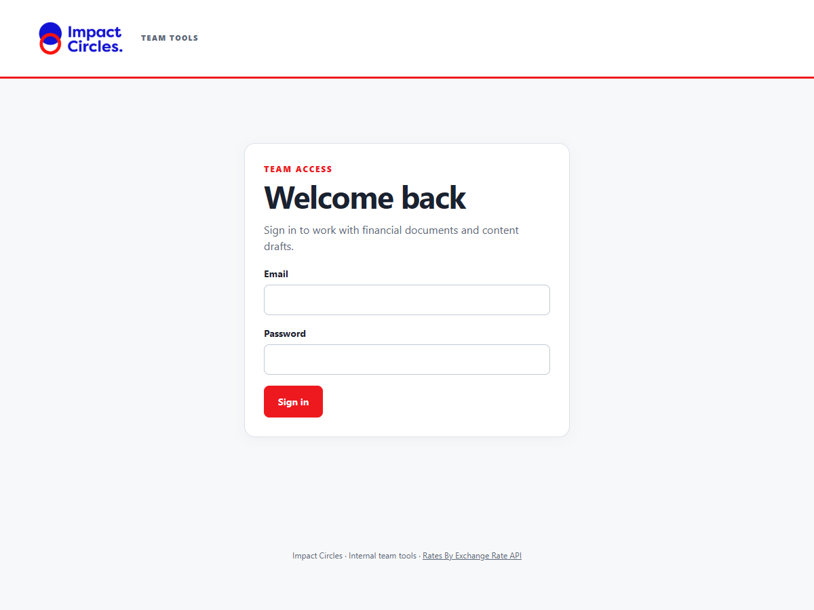
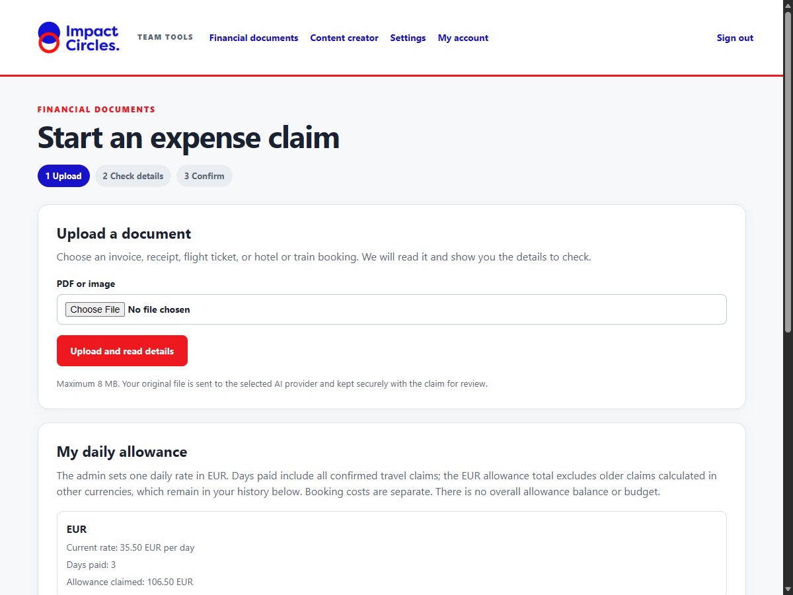
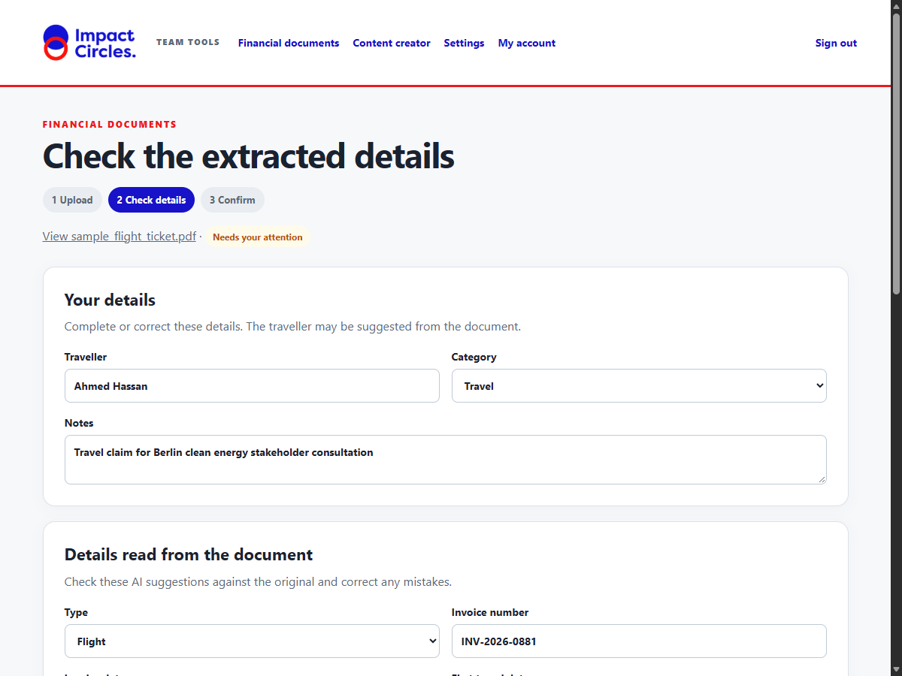
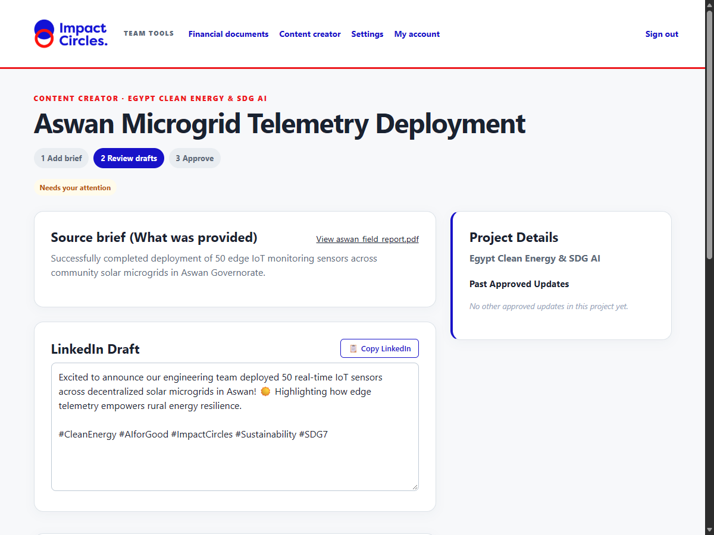

# Impact Circles Staff User Guide

One unified web application for managing financial travel claims and generating project-consistent organization content.

All screenshots below are generated from a local synthetic demonstration environment using non-sensitive example data.

---

## 1. Sign In & Account Security

Open your application URL (for example, `http://127.0.0.1:8000` in local testing, or `https://tools.impactcircles.org` in production). Enter your work email and password.

- **No terminal or Python setup:** Staff use only standard web browsers (Chrome, Edge, Firefox, Safari).
- **Session Security:** The application issues a secure HTTP session cookie (`impact_session`) that protects against session tampering and cross-site scripting. Login attempts are rate-limited to protect against brute-force guessing.
- **Change Password:** You can change your password at any time by clicking **My account** in the top navigation bar. Passwords must be at least 12 characters.

---

## 2. Financial Documents & Expense Claims

Staff use a transparent 3-step verification flow: **Upload → Check details → Confirm**.

### Step 1: Upload Your Document
1. Navigate to **Financial documents** (`/finance`).
2. Attach your original PDF ticket, hotel receipt, vendor invoice, or train voucher (up to 8 MB; supported formats: PDF, JPEG, PNG, WebP).
3. Click **Upload and read details**.
4. The system sends the raw document bytes directly to the multimodal AI model, which extracts candidate facts without performing arithmetic. Reading can take up to 90 seconds.
5. The original file is stored on the server's disk with the claim. It is not read again from your device after upload. You can open your own original from the review page; an admin can open any claim's original. Other members cannot open it through the app.

### Step 2: Check Extracted Details & Enter Personal Information
1. On the review page (`/finance/{id}`), click **View [document name]** in the header to open and inspect your original document side-by-side in a new browser tab.
2. Complete **Your details**:
   - **Traveller:** Enter or confirm your full name (the AI may suggest this from passenger fields).
   - **Category:** Select the appropriate budget category from the dropdown (e.g., *Travel*, *Accommodation*, *Meals*, *Operations*, *Other*).
   - **Notes:** Add internal context or mission notes for accounting.
3. Review **Details read from the document**:
   - **Document Type:** Choose *Invoice*, *Receipt*, *Flight*, *Hotel*, *Train*, or *Other*.
   - **Invoice Details:** For invoices and receipts, verify the *Invoice number* and *Invoice date*.
   - **Travel Details:** For travel bookings, verify *First travel date*, *Last travel date*, *Origin*, and *Destination*.
   - **Financials:** Verify *Vendor*, *Document amount*, and *Currency*.
4. Inspect the **Calculation Card**:
   - Invoices and receipts do not receive a daily per diem allowance.
   - Travel documents calculate calendar days inclusively (departure day + return day).
   - Each account receives a daily allowance only once for each travel date. If another confirmed ticket or booking on your account already paid that day, the new claim shows it as previously claimed and pays allowance only for new dates. Separate booking costs can still be included. The traveller name printed on a ticket does not move the claim to another account.
   - A single travel claim must cover 1–365 days. A longer period remains an unconfirmed draft until its dates are corrected.
   - The admin sets one daily allowance rate in EUR. Every claim total and allowance is shown in EUR.
   - A receipt in another currency is converted to EUR using a daily reference rate. Check the original amount, conversion rate, rate date, and EUR total. If a recent rate is unavailable, confirmation waits until the rate service works again.

On the **Financial documents** page, **My daily allowance** shows the current EUR rate and the days and EUR allowance already paid on your confirmed travel claims. **My claim history** lists your own confirmed and pending documents. Other team members cannot see your claims. There is no overall per diem budget or remaining balance in the current rules.

If you have an older confirmed claim calculated in another currency, its original amount remains in history. Its paid travel days count toward the days already used, while its old non-EUR allowance is not added to the EUR allowance subtotal.

**Delete a draft:** Before confirming, open your claim and choose **Delete draft** at the bottom of the page. Accept the browser prompt to remove both the draft and its uploaded document. This option is not available after confirmation; ask the finance team to correct a confirmed claim.

**Example:** At 35.50 EUR per day, a 120.00 EUR flight covering 10–12 November pays 3 × 35.50 = 106.50 EUR allowance, for a 226.50 EUR total. A 90.00 EUR hotel booking for 11–12 November on the same account receives 0.00 EUR extra allowance because both days were already paid; its total is 90.00 EUR when booking costs are included.

### Step 3: Confirm & Google Sheets Export
1. Click **Confirm and save claim**.
2. You will move to a separate **Claim confirmed** page. It shows your claim ID and total, with an **Upload another document** button that returns to the first finance page.
3. The claim calculation is locked into SQLite. If a foreign currency was used, the EUR total is saved with the record.
4. The claim is exported to the team Google Sheet (`Finance` tab) via an Apps Script webhook. The exported row records the document metadata, amounts, review URL, creator's name/email, and confirmer's name/email.
5. **Retry on Connection Failure:** If Google Sheets is temporarily unreachable, your claim remains safely saved in SQLite. The confirmation page shows an alert and a **Try Google Sheets again** button. You do not need to re-upload the document.

### Duplicate Detection & Admin Queue
- When uploading or confirming a document, the application checks against all existing confirmed claims:
  1. Exact document byte match (SHA-256 hash).
  2. Matching normalized invoice number and vendor.
- If a match is found:
  - The record is flagged with status **Needs admin review**.
  - A warning alert informs you that an administrator must review the document before it can be confirmed.
  - Team members cannot confirm flagged duplicates; only administrators can inspect the earlier claim and confirm an exception with a recorded business reason.

---

## 3. Project-Aware Content Creator

Generate tailored, publication-ready drafts across LinkedIn, newsletters, and website updates while preserving project voice, milestone continuity, and factual precision.

### Step 1: Select Your Project Scope
1. Open **Content creator** (`/content`).
2. Select your active project from the dropdown (e.g., *Egypt Clean Energy & SDG AI*, *Berlin Urban Mobility AI*, or *General / Unassigned*).
3. If starting a new initiative, use the **+ Add a new project** section to define the project name and background narrative.
4. **Permissions:** Team members can access and create content only for projects assigned to them. Administrators can view, create, and reassign ownership across all projects.

### Step 2: Provide What Is New
1. Enter a clear working **Title**.
2. Provide the **Source brief (What is new)**: factual bullet points, verified milestones, quotes, or metric changes.
3. Optionally attach a supporting document (PDF report or image announcement).
4. Click **Create 3 drafts**.
5. **Context Boundaries:** The AI is provided with your project description and up to three recent approved posts from the same project. Team members' requests use only their own approved prior posts; administrators' requests can reference approved posts from all project contributors. The prompt instructs the model to preserve style and tone without hallucinating unverified events.

### Step 3: Review, Copy & Approve
1. The review screen (`/content/{id}`) displays your original brief alongside three dedicated publication cards:
   - **LinkedIn Draft:** Professional networking post structured with key achievements and relevant hashtags.
   - **Newsletter Draft:** Stakeholder digest emphasizing partner updates and narrative context.
   - **Website Draft:** Structured article with title, lead paragraph, and subheadings.
2. **One-Click Copy:** Click the **📋 Copy LinkedIn Draft** (or Newsletter/Website) button on any card. The button will change to **Copied!** in green and place the text directly onto your clipboard.
3. **In-Place Editing:** You can edit the text directly within any draft's textarea before approving.
4. Click **Approve these 3 drafts**.
5. Approved drafts are recorded in SQLite and exported to the team Google Sheet (`Content` tab) with creator and approver attribution. If configured by an administrator, approved drafts can also be automatically dispatched to an external publishing webhook.

---

## 4. Troubleshooting & FAQ

- **Document reading takes longer than expected:** The upload form displays a polite status message (*"Reading your document. This may take up to 90 seconds"*). If the external AI provider is experiencing latency, wait for the response. If the request times out after 90 seconds, check your network and retry. Avoid rapid multi-clicking.
- **File rejected during upload:** Ensure your file is an authentic PDF, JPEG, PNG, or WebP under 8 MB. Files exceeding 8 MB or other formats will be rejected with a clear browser error.
- **Duplicate warning alert:** If your document matches an existing confirmed claim, do not create duplicate accounts or change vendor spelling to bypass it. Contact an administrator to review the flagged record in the admin queue.
- **Google Sheets export needs attention:** If a red alert appears stating *"Saved here, but Google Sheets needs attention"*, your claim or draft is safely stored in the application database. Notify your administrator to check the Apps Script execution logs, then click **Try Sheets again** once the issue is resolved.
